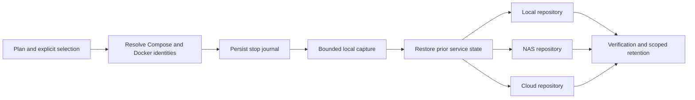

# Backup And Recovery Architecture

## Ownership And Boundaries

[ADR 0005](../adr/0005-native-backup-orchestration.md) selects native restic and
rclone. `internal/backup` owns destination configuration, logical source plans,
capture, copy results, schedules and recovery. HTTP controllers authenticate,
reject cross-origin mutations, validate JSON and admit work to the existing
application lifecycle. The frontend consumes the canonical
[OpenAPI contract](../api/openapi.yaml). Backup jobs use the existing job states,
activity streams, cancellation, audit and notification dispatch.

Restic repositories remain independently recoverable. Restic supplies encrypted
storage, content deduplication, snapshot integrity and retrieval. Google Drive
uses an authorized rclone remote; S3 uses native restic S3; SFTP uses pinned SSH
host keys. The backend never accepts arbitrary restic flags, shell hooks or
password commands. Repository passwords and transport credentials are write-only
API input, stored in private files, and excluded from logs and audit details.

## Capture And Copy

A source identifies stack, Compose service and mount target; the resolved source
path is pinned when selected. Resolution repeats before capture. A replaced,
missing or inaccessible mount fails the run instead of silently changing the
selection. Shared physical data is captured once, retaining aliases and all
writer relationships. Container writable layers and downloadable images are
not sources. A new mount remains unselected and appears in stack coverage.

File mode is explicitly a live file copy. Stop mode discovers all writers,
records which containers were running, persists restart intent before stopping,
and resumes only those containers before upload. The disruption deadline covers
capture; cancellation and failure use an independent bounded cleanup context.
Startup replays capture restart intent before ordinary job reconciliation or
request admission. Restore journals switch to a durable hold-stopped state
before the first data write: a failed or interrupted restore never automatically
starts services against partially replaced data. Failed service recovery prevents
startup so a new job cannot obscure an unresolved outage. Already stopped
services stay stopped.

Each logical source becomes a native GNU tar archive in a private prepared set.
This preserves numeric ownership, mode, links and supported ACL/xattr metadata
without requiring the restic process to run as root. The manifest version,
source mapping, aliases, writer relationships, capture mode, Stacklab version,
image prerequisites and warnings travel inside every repository copy. A
repository can be restored without the live Stacklab database.

Stacklab state uses SQLite `VACUUM INTO`, including committed WAL data in a
standalone consistent database. Other state files and effective layout metadata
are captured separately; live database files, staging, caches and restore work
areas must not be recursively included. Private state contains credentials and
must remain protected before encryption as well as in the repository.

## Coordination And Failure Semantics

The first implementation deliberately takes the existing global job resource
for backup and repository operations. This serializes repositories and prevents
races with stack changes, Docker cleanup, volume removal, daemon changes and
self-update. Reads remain available. This conservative rule costs concurrency
during long uploads but keeps shared-volume and recovery behavior predictable
on a single homelab server; narrower resources can be introduced later without
changing the public contract.

A run records capture outcome separately from each destination's upload,
verification and retention. A failed remote copy does not erase successful
copies. Overall failure remains visible through the parent job. A retry uses
the same prepared set and targets failed copies; it never recaptures silently.
Expired or removed staging requires a new run. Plans carry explicit staging
byte, lifetime and stop-time limits. Repository maintenance only operates on
Stacklab-owned, plan-scoped snapshots; foreign/adopted snapshots are not subject
to new retention policies.

Local destinations pin a filesystem device identity and check it before every
repository operation. Missing mounts fail closed. Device renumbering after a
reboot requires an operator to verify and update that identity. Repositories
cannot overlap selected source data or private staging. A local copy on the
same physical storage is useful for recovery exercises but does not protect
against loss of that storage.

## Scheduling And Persistence

Public configuration and run summaries are persisted as versioned `backup.v1`
application state in SQLite. Credentials live below
`<STACKLAB_DATA_DIR>/backup/credentials`; prepared sets, caches and isolated
restores have separate directories under the same private backup root. No
credentials are placed in workspace Git. The run retains the plan revision
used for capture so editing a plan cannot change a retry's selection or policy.

Each destination assignment has an enabled flag, explicit daily/weekly/manual
schedule, timezone and daily/weekly/monthly retention. Background execution is
owned by the application lifecycle, shares the same jobs and resources as manual
runs, and is drained before storage closes. Schedules coalesce destinations due
together into a single capture; missed work and conflicts must remain visible.

## Recovery And Privilege

Isolated restore is the default. It creates a new directory and never overlays
an existing target. Repository checks and isolated restore tests are separate
results: checking repository structure does not prove application recovery.
Operators must inspect restored application data and supply external networks,
registry access, build inputs and separately managed secrets before deployment.

Protected managed data and supported local Docker volumes use the optional
`stacklab-backup-helper`. Its root-owned configuration defines the path boundary;
it exposes only `archive`, `restore`, `check-target` and the exact-file
`service-config` read. It validates operations and archive entries and does not
offer a general command runner. The application itself remains non-root.
Unsupported drivers, paths, permissions and metadata must fail explicitly.
Archives with set-user-ID metadata, set-group-ID files or Linux file
capabilities are rejected before privileged extraction. Set-group-ID directories,
ordinary ownership/modes, ACLs and user xattrs remain supported.
Fresh-host recovery is also possible with restic and GNU tar; see the
[operator recovery procedure](../ops/backup-and-recovery.md).
