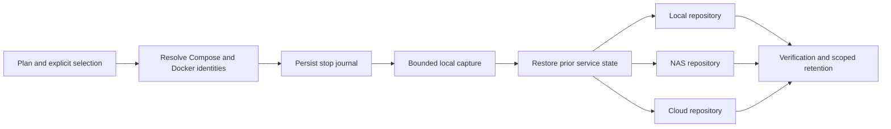

# Backup And Recovery Architecture

## Ownership And Boundaries

[ADR 0005](../adr/0005-native-backup-orchestration.md) selects native restic and
rclone. `internal/backup` owns destination configuration, logical source plans,
capture, copy results, schedules and recovery. HTTP controllers authenticate,
reject cross-origin mutations, validate JSON and admit work to the existing
application lifecycle. The frontend consumes the canonical
[OpenAPI contract](../api/openapi.yaml). Backup jobs use the existing job states,
activity streams, cancellation, audit and notification dispatch.

Restic repositories remain independently recoverable. Restic supplies encrypted
storage, content deduplication, snapshot integrity and retrieval. Google Drive
uses an authorized rclone remote; S3 uses native restic S3; SFTP uses pinned SSH
host keys. The backend never accepts arbitrary restic flags, shell hooks or
password commands. Repository passwords and transport credentials are write-only
API input, stored in private files, and excluded from logs and audit details.

## Capture And Copy

A source identifies stack, Compose service and mount target; the resolved source
path is pinned when selected. Resolution repeats before capture. A replaced,
missing or inaccessible mount fails the run instead of silently changing the
selection. Shared physical data is captured once, retaining aliases and all
writer relationships. Container writable layers and downloadable images are
not sources. A new mount remains unselected and appears in stack coverage.

File mode is explicitly a live file copy. Stop mode discovers all writers,
records which containers were running, persists restart intent before stopping,
and resumes only those containers after capture and archive validation, before
index hashing or upload. The disruption deadline covers the stopped capture
period; cancellation and failure use an independent bounded cleanup context.
Startup reconciles capture restart intent before ordinary job reconciliation.
Per-writer journal phases distinguish an unrequested stop from a daemon-side stop
that may still be running after process death. Recovery fences the latter with a
bounded stop before starting the recorded container. Missing/recreated identities,
malformed journals and held restores stay visible through the available panel;
unsafe capture/apply remains blocked until resolved. Acknowledging a held restore
never starts services or deletes helper rollback data. Already stopped services
stay stopped. Docker graceful stop settings are respected; the plan disruption
budget still bounds the complete stopped capture period.

Each logical source becomes a native GNU tar archive in a private prepared set.
This preserves numeric ownership, mode, links and supported ACL/xattr metadata
without requiring the restic process to run as root. The manifest version,
source mapping, aliases, writer relationships, capture mode, Stacklab version,
image prerequisites and warnings travel inside every repository copy. A
repository can be restored without the live Stacklab database.

Stacklab state uses SQLite `VACUUM INTO`, including committed WAL data in a
standalone consistent database. Other state files and effective layout metadata
are captured separately; live database files, staging, caches and restore work
areas must not be recursively included. Private state contains credentials and
must remain protected before encryption as well as in the repository.

## Coordination And Failure Semantics

Capture and reviewed apply take exclusive lifecycle coordination. After capture
and service compensation, the job atomically replaces that reservation with
repository resources and uploads immutable staging. Up to two independent copies
can transfer concurrently. Repository reservations use normalized identity, pin
configuration/credentials, and exclude conflicting reads/mutations of the same
repository. Unrelated stack operations and repository reads remain available.
Native restic locks remain authoritative, including external processes and aliases
that cannot be recognized as the same remote repository locally. Self-update still
drains active jobs. No automatic force-unlock is performed.

Small repository commands have a 90-second deadline. Backup transfer has a
five-minute no-progress watchdog and the job retains a 24-hour execution limit.
Cancellation first signals restic to finish, then forces termination after a
bounded grace period. Error categories are secret-safe and support the declared
restic version range rather than assuming new exit codes on older versions.

A run records capture outcome separately from each destination's upload,
verification and retention. A failed remote copy does not erase successful
copies. Overall failure remains visible through the parent job. A retry uses
the same prepared set and targets failed copies; it never recaptures silently.
Expired or removed staging requires a new run. Fully successful staging is removed
promptly; expiry cleanup skips active runs. Retry lifetime is independent of the
24-hour execution deadline. Plans carry explicit staging
byte, lifetime and stop-time limits. Retention forgets only Stacklab-owned,
plan-scoped snapshots; foreign/adopted snapshots are not subject to new retention
policies. Checks inspect the repository, and prune reclaims unreferenced packs
without forgetting foreign snapshots.

Local destinations pin a filesystem device identity and check it before every
repository operation. Missing mounts fail closed. Device renumbering after a
reboot requires an operator to verify and update that identity. Repositories
cannot overlap selected source data or private staging. A local copy on the
same physical storage is useful for recovery exercises but does not protect
against loss of that storage.

## Scheduling And Persistence

Public configuration and run summaries are persisted as versioned `backup.v1`
application state in SQLite. Credentials live below
`<STACKLAB_DATA_DIR>/backup/credentials`; prepared sets, caches and isolated
restores have separate directories under the same private backup root. No
credentials are placed in workspace Git. The run retains the plan revision
used for capture so editing a plan cannot change a retry's selection or policy.

Each destination assignment has an enabled flag, explicit interval/daily/weekly/manual
schedule, timezone and daily/weekly/monthly retention. Background execution is
owned by the application lifecycle, shares the same jobs and resources as manual
runs, and is drained before storage closes. Schedules coalesce destinations due
together into a single capture; missed work and conflicts must remain visible.

Interval schedules run every 1–168 hours, anchored to the Unix epoch in UTC.
Calendar schedules use the configured IANA timezone (host local by default).
Nonexistent daylight-saving wall times are skipped; repeated wall times run
once. Schedule previews and the scheduler share the same occurrence calculation.
Repository check and prune have independent schedules and durable occurrence
markers. A conflict leaves the occurrence due; a started failure is reported
once instead of creating a retry storm. A scheduled prune separates per-copy
forget from pack cleanup; configurations without it keep the existing
forget-and-prune behavior. Native restic locks remain authoritative.
New or changed schedules start at their next future occurrence. Unchanged
schedules retain their durable occurrence marker and coalesce missed work after
restart; legacy schedules without a marker retain their catch-up behavior.

## Protection Evidence And File Catalogs

The overview derives protection on the server. Durable last-verified-copy
checkpoints survive bounded run-history cleanup and bind the capture to a
fingerprint of the plan's sources, exclusions and consistency mode. Uploading
an older prepared set again cannot refresh its capture time. Changed selection
requires a new capture. Manual copies show their age without claiming a recovery
point objective; disabled assignments do not count as expected copies.
Complete-object-verified snapshots remain useful if subsequent retention fails, while
that failure stays visible. Repository access, integrity check and last-operation
outcomes have separate fields; an invalid recovery review is not an access test.
A run-tag match is only an adoption candidate: compare the prepared manifest and
every expected recovery object's path/type/size before recording success. Restic
partial snapshots are retained for inspection but cannot satisfy a retry. This
proves object completeness, not the readability of every data block.

Protection reconciles snapshot inventory after inspection/maintenance and in the
background, records the evidence age, and exposes missing, unverified, integrity,
availability and clock-skew states. A failed inventory read does not mean deletion.
Legacy metadata-only checkpoints require complete-object verification. Recovery
exercise evidence belongs to its exact snapshot. Future occurrence/checkpoint
markers cannot silently suppress future work after a clock correction.

Before a manual run, preflight resolves source identities and actual shared
writers. It does not reserve the result: execution resolves them again under the
normal job lock. Run phases distinguish capture, upload, verification and
retention. Bounded restic JSON progress contributes byte/file counters; unknown
work is not assigned an invented percentage. These native file counts describe
the uploaded recovery objects (archives, indexes and manifest), not individual
application files inside archives. Capture and service downtime have separate
durations; the captured timestamp is fixed before index hashing.

Each newly captured source archive has a versioned `indexes/<sourceID>.json`
inside the encrypted snapshot. The index comes from the captured tar bytes,
including relative paths, content hashes, entry types, links, ownership, modes,
timestamps and a digest of extended metadata. Limits are 100,000 entries and
12 MiB per source; index bytes count toward the staging budget. Exceeding an index
bound preserves the complete archive and records an inspection limitation. A
legacy local fallback has the same bounds; no truncated index is presented as
complete. Remote browsing
reads bounded manifest/index metadata, never the entire source archive. File
comparison distinguishes content changes from metadata changes, including
ownership, mode, modification time and ACL/xattr changes. Directory listings
show immediate children; comparison covers the complete selected subtree.

An isolated recovery result has a stable ID, job ID, creation time and selected
source/file scope in the existing versioned state. Legacy directory registrations
receive deterministic IDs. The library reports missing results as unavailable.
Old snapshots without indexes remain usable through isolated restore and a
private local index where the bounds permit it. Registered results can be removed
explicitly: Stacklab-owned directories are deleted, while forgetting custom
results removes only their registration. Custom files remain operator-owned;
a full 200-entry library requires cleanup
before another restore. Partial recovery downloads complete containing archives
but materializes only the selected regular files (at most 100 per request).
Space estimates use authenticated restic metadata for the selected archives and
indexes, including the manifest, rather than the size of the full snapshot.
Partial-file results cannot supply
online apply, including through the legacy directory API.

Authenticated downloads stream regular archive members from registered results
as private attachments. No caller-supplied host path is opened. Path traversal,
archive links and unselected files are rejected. Apply resolves the registered
ID, verifies destination/snapshot identity, and retains the existing archive-
and-writer-bound, single-use review token.

## Recovery And Privilege

Isolated restore is the default. It creates a new directory and never overlays
an existing target. Repository checks and isolated restore tests are separate
results: checking repository structure does not prove application recovery.
Operators must inspect restored application data and supply external networks,
registry access, build inputs and separately managed secrets before deployment.

Protected managed data and supported local Docker volumes use the optional
`stacklab-backup-helper`. Its root-owned configuration defines the path boundary;
it exposes archive/target checks, prepared restore operations and the exact-file
`service-config` read. It validates operations and archive entries and does not
offer a general command runner. The application itself remains non-root.
Unsupported drivers and paths fail explicitly. Unsupported automatic recovery
metadata remains preserved in the archive with an explicit offline-recovery
restriction. Retrieving that archive is not a successful full restore exercise.
Archives with set-user-ID metadata, set-group-ID files or Linux file
capabilities are rejected before privileged extraction. Set-group-ID directories,
ordinary ownership/modes, ACLs and user xattrs remain supported.
Before downtime, the helper seals and validates input into root-owned disk
storage at `/var/lib/stacklab-backup-helper` and binds a preparation token to the
target and mode. It rechecks target safety immediately before mutation. Successful
operations release prepared data; interrupted writes retain journal/token evidence
for operator inspection. Default temporary storage and unsealed mutable file
descriptors are not substitutes for this protected copy.

Complete-directory apply defaults to replace; explicit merge retains unrelated
entries. Single-file sources replace only their selected basename and never clear
the parent directory. Replacement preserves the target mountpoint, refuses nested
mounts, moves existing children to a rollback directory on that filesystem and
extracts the source. Failed extraction attempts restore the previous contents;
services nevertheless remain stopped once mutation might have begun. This is not
an atomic transaction across sources or an automatic application rollback after
process death. Directory metadata, ownership, ACLs/xattrs and hardlink boundaries
remain part of the recovery contract.

Fresh-host recovery is also possible with restic and GNU tar; see the
[operator recovery procedure](../ops/backup-and-recovery.md).

## Operational Policy

`backup_policy.v1` stores a global scheduling/retention pause, host identity,
overdue grace (default 60 minutes), alert transition markers and a write-only
optional HTTP(S) protection heartbeat URL. A changed host identity pauses automatic
work until explicit review; cloning the same machine identity cannot be detected
this way and requires an operator pause. Existing plans without a saved host
identity also require a one-time review: an in-place upgrade cannot be
distinguished safely from recovery of legacy state on a different host.

An independent background worker detects overdue copies while transfers run,
delivers transition alerts through the existing failure-notification channels,
and sends a success heartbeat at most once a minute only while enabled scheduled
copies have acceptable current protection evidence. No scheduled assignments means
no heartbeat. Pausing stops heartbeats; an external monitor's expected interval
must account for grace and operator maintenance. Redirects are not followed and
URLs never appear in public settings or diagnostic errors. Only that external
monitor can detect a completely stopped Stacklab process.
