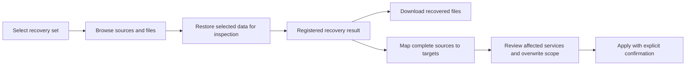

# Backup Protection And Recovery Experience

## Status And Intent

Implementation plan accepted on 2026-10-13 and committed before implementation.
The six delivery steps below are implemented; validation evidence is recorded in
[backup validation](../quality/backup-validation.md).
The [native backup baseline](backup-and-recovery.md) remains the starting point.
The subsequent [reliability plan](backup-reliability.md) records review findings,
release blockers and the accepted repair sequence.
After delivery, executable tests and the updated architecture, API and operator
documents define the implemented contracts.

New or edited schedules start at their next future occurrence. Existing schedules
still catch up one missed occurrence after downtime. Repository browsing uses
temporary reservations to pin credentials and coordinate access to that repository;
it does not create a persistent job for each directory listing. Capture coordinates
host mutations, while slow transfers do not hold that host-wide reservation.
Complete-directory apply defaults to exact replacement with reviewed removal of
extra files; explicit merge and single-file apply preserve neighboring content.

The operator must be able to answer three questions without reading job logs:
what is protected, what needs attention, and how to recover the required data.
Backrest is a reference for useful interaction patterns. Review of a running
Backrest instance showed a useful protection
summary, dated operation history, file browser, repository statistics and
maintenance controls. Its [configuration guide](https://garethgeorge.github.io/backrest/introduction/getting-started)
and [hooks documentation](https://garethgeorge.github.io/backrest/docs/hooks)
describe its broader general-purpose backup workflow.

Stacklab should retain its own visual system, terminology, job lifecycle and
Compose-aware source model. Preserve explicit selection, shared-writer handling,
independent copies and reviewed recovery. A configured plan, an uploaded copy,
a repository check and a successful recovery exercise are distinct evidence.

## Navigation And Information Hierarchy

The Backups screen opens with **Protection**. Other views are **Recovery**,
**History**, **Plans**, and **Destinations**. Existing links remain usable,
including the previous runs view. Stack-level backup coverage links to the
relevant plan and recovery context. Desktop and mobile share these workflows;
wide tables have a usable small-screen presentation and dialogs retain keyboard
navigation, focus management and explicit progress/error states.
Visited tabs retain Recovery selections/job progress and History filters. Background
refreshes preserve the layout and file-search focus. A selected recovery destination
is reflected in the URL; stack and plan links open the corresponding editing context.

Protection shows per-plan and per-destination evidence, outstanding source
coverage, next occurrences and actions to resolve problems. History focuses on
execution and diagnosis. Configuration is secondary to these operational views.

## Delivery Steps

### 1. Protection Evidence And Accurate Status

- Calculate protection on the server, using capture time rather than retry
  upload time. A successful copy requires verifying the manifest and its referenced
  recovery objects, including when adopting a snapshot left by an interrupted
  upload. Snapshot metadata alone is insufficient. A later retention failure is
  a separate maintenance outcome.
- Keep durable last-verified-copy checkpoints independently of the bounded run
  history. Bind those checkpoints to the selected source configuration so a
  changed selection cannot inherit a misleading current status.
- Show expected/current copies, last capture, next run and overdue/manual/never
  backed-up states. Disabled destinations do not count as promised copies.
  Manual plans show age and their own available-copy count without inventing a
  freshness guarantee.
- Display discovered stack/source coverage separately from successful-copy
  evidence. Surface unconfigured data, changed mounts and discovery failures.
- Separate access/integrity outcomes from the last operation result. A stale
  restore review must not imply that a repository is unavailable.
- Display snapshot presence with its observation time, repository availability and
  integrity separately. Missing snapshots, failed integrity, unverified content and
  future timestamps cannot appear as healthy protection. A recovery-test timestamp
  belongs only to the protected snapshot that was actually tested.
- Make immutable repository backend/location fields read-only during editing.

### 2. History, Preflight And Execution Progress

- Add filtering by plan, destination, status and date, readable names, search
  and bounded pagination. Keep capture and individual copy outcomes visible.
- Before manual backup, show the currently affected writers and warnings,
  including services from other stacks. Re-resolve them when execution starts.
- Report capture, upload, verification and retention phases with timestamps,
  duration and available byte/file counters. Use native restic progress where
  available; do not fabricate percentages or ETAs for unknown-size phases.
- Retain the existing job drawer, cancellation, retry semantics and audit trail.
- Observe every operation started from the page, so completing an earlier job
  still refreshes its outcome after another operation starts. Keep errors scoped
  to their action rather than leaking into unrelated review dialogs.

### 3. Continuous Recovery And A Restore Library

- Persist successful isolated recovery results with stable IDs, destination,
  snapshot, creation time, job ID, completeness and target directory.
- Show those results in Recovery. On job completion, continue into the correct
  result automatically. Users never need to copy a path from a job log.
- Preserve the existing reviewed apply token, explicit target mapping, default
  stopped services and offline-only recovery of private Stacklab state.
- Complete directory mappings default to replacement: remove entries absent from
  the recovered source. Offer explicit merge with a warning that extra files can
  invalidate database recovery. Single-file mappings preserve sibling files.
  Show this choice and its removal scope in the server review before `RESTORE`.
- Keep manifest loading and retry visible and focus the typed confirmation once
  preview completes. Sources whose preserved metadata requires offline extraction
  cannot be selected for automatic apply.
- Partial file recoveries are clearly identified and cannot masquerade as a
  complete source for in-place apply. Missing or manually removed result files
  produce an actionable unavailable state.
- Older registered restores and snapshots remain accessible through a compatible
  inspection path; no repository migration is required.
- Full offline retrieval is available separately from a full recovery exercise.
  Restricted metadata can be retrieved as original archives without earning a
  completed-test claim. Managed results can be deleted with their local data;
  custom results can be forgotten without deleting their files. Confirm the
  distinction and preserve repository snapshots in both cases.

### 4. Snapshot File Browser, Comparison And Download

- Store a versioned, bounded file index alongside each source archive inside
  the encrypted recovery set. Include normalized relative paths, entry type,
  size, modification time, content digest and relevant link/permission metadata.
- Build the index from captured bytes rather than traversing changing live data
  again. Account for its storage in the staging budget. Exceeding a browsing/index
  bound disables that optional index with an explicit reason; it must not prevent
  a complete archive backup. Preserve source metadata independently of whether
  automated extraction is permitted.
- Expose paginated directory browsing and search. Compare two recovery sets at
  file level, showing added, removed, content-changed and metadata-changed files.
  Keep search/navigation controls mounted during loading, preserve keyboard focus
  and prevent stale result rows from selecting files in a different source/query.
- Support selecting sources or individual regular files for isolated recovery.
  Display that the current format downloads the containing source archive;
  estimate transfer/storage from that selection rather than the whole snapshot.
- Offer authenticated attachment downloads from registered recovery results.
  Validate archive paths, source identities and regular-file membership; never
  serve arbitrary host paths or follow archive/target symlinks.
- Older snapshots without an index explain the limitation. Local index generation
  after retrieval has the same bounds and may also be unavailable; original archive
  downloads provide offline inspection and recovery. Restic continues to deduplicate
  archive blocks, but every capture still reads and stages the complete selected
  data. Replacing the archive representation is separate architectural work.

### 5. Schedules And Repository Maintenance

- Add backups every N hours alongside manual, daily and weekly schedules, with
  documented interval anchoring and timezone behavior.
- Preview upcoming occurrences in the plan editor. Show the actual next
  occurrence in Protection and keep missed-run coalescing and conflict retry.
  Format preview dates in the displayed timezone rather than the browser zone;
  an unresolved host-zone name falls back to a labelled UTC preview.
- Configure independent repository check and prune schedules. Checks retain an
  explicit data-read policy and disclose possible provider transfer charges.
- Keep retention scoped to Stacklab-owned plan snapshots. Separate scheduled
  prune from per-backup forget where a prune policy is configured, while
  preserving existing behavior for configurations that have no new policy.
- Keep all repository maintenance under the existing resource and native restic
  locks. Do not introduce automatic force-unlock.
- Review manual cleanup costs/locking before starting. All-zero retention keeps
  every snapshot, and an unmeasured repository size remains unknown.
- Provide a global pause for scheduled copies, checks and cleanup. Recovered state
  on a different host requires reviewing its sources, mappings and repositories
  before acknowledging that host and resuming scheduling.
- Configure overdue alert grace and an external success heartbeat. Its URL remains
  write-only. The independent monitor must detect missing heartbeats, including a
  stopped host; manual-only plans do not produce success heartbeats.
- Keep the panel available for unresolved service recovery. Display recorded
  identities/phases, retry ordinary interrupted recovery, and require explicit
  inspection acknowledgement for held data. Acknowledgement keeps services stopped
  and preserves rollback files. Corrupt records require operator repair.

### 6. Guided Setup And Usable Forms

- Guide destination creation through provider/connection, credentials, and
  access test or initialization, then into the first plan and backup.
- Use dedicated connection fields for supported providers where possible;
  retain an explicit advanced URI path for existing repository configurations.
- Preserve SFTP absolute versus home-relative path semantics, including ports and
  IPv6. Do not rewrite immutable existing repository addresses.
- Generate new repository passwords with browser cryptographic randomness and
  remind operators to keep recovery credentials independently of the host.
- Hide generation during editing. Stored password replacement requires an explicit
  choice and a password matching the repository, then offers access testing; this
  operation does not rotate repository encryption keys.
- Preserve write-only secret handling. Google Drive continues to accept an
  independently authorized rclone configuration; embedded OAuth is separate work.
- Structure plan editing into readable sections, with source search, grouped
  selection, exclusions, per-destination policies and advanced capture limits.
- Confirm discarding dirty forms on Escape, backdrop dismissal and cancellation.
  Preserve empty numeric inputs while editing. Keep unknown destination assignments
  visible and removable rather than silently submitting hidden selections.

## Architecture And Compatibility

Additive REST schemas remain canonical in [OpenAPI](../api/openapi.yaml), with
generated frontend types. New reads use normal authentication; mutations use
existing same-origin checks and application-owned workers. File downloads are
authenticated attachments with private cache policy and safe filenames.

Maintain `backup.v1` compatibility by defaulting additive fields. Preserve old
manifest support, existing plans, snapshots, retries and offline restic/GNU tar
recovery. Indexes travel inside the encrypted repository; local catalogs and
recovered data remain private and bounded. Preserve tar ownership/ACL/xattr
guarantees and the narrow helper boundary.

Capture retains host/service coordination; transfers and metadata reads use
repository-scoped coordination. UI requests must not bypass those reservations or
start untracked restore processes. Large catalog and download operations need
cancellation and explicit bounds. Failures
must not expose credentials or silently produce incomplete recovery results.

## Acceptance And Validation

1. Protection differentiates configuration, freshness, snapshot presence, access,
   integrity and snapshot-scoped recovery exercises. Include retained checkpoints,
   failed retention, partial snapshots and clock anomalies.
2. History filters and paging work with mixed outcomes and more than one page.
   Preflight shows actual shared writers. Progress retains meaningful units.
3. A user selects a recovery set, restores data, inspects/downloads a file and
   enters reviewed apply without typing an intermediate filesystem path.
4. Native encrypted-repository tests cover indexes, comparison, partial file
   recovery, legacy fallback and exact downloaded bytes. Traversal, writes through
   symlinks, unsafe extraction and unregistered paths are rejected; oversized optional indexes
   preserve complete backup/retrieval and expose their browsing limitation.
5. Interval/DST boundaries, maintenance schedules, missed occurrences,
   cancellation and resource conflicts have deterministic tests.
6. Browser exercises cover desktop and mobile, empty/error/loading states,
   setup, source selection, history and recovery. Real Debian/Docker validation
   covers metadata, shared services and helper-backed apply after UI changes.
   Regressions include typing after debounce beside global navigation shortcuts,
   different browser/schedule zones, tab persistence, scoped errors, host-review
   acknowledgement, held recovery and managed versus custom result removal.
7. Run the canonical Go/frontend/docs/hygiene checks and targeted race tests;
   validate generated API drift and release build where affected.
8. Update architecture, API, operations, UI and validation records to match the
   delivered behavior, then commit the tested implementation steps.

## Subsequent Work

Scheduled isolated restore tests need an explicit automatic cleanup/quota policy
before unattended operation. Database dump profiles, pre-update backups, richer
application probes, arbitrary cron, additional notification channels and embedded
provider OAuth remain follow-up work. Raw command hooks, multi-host management
and an unrestricted restic command console are not required for this experience.
