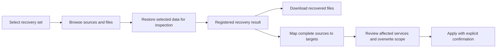

# Backup Protection And Recovery Experience

## Status And Intent

Implementation plan accepted on 2026-10-13. Commit this plan before implementing
the changes below; deliver subsequent work in coherent, tested commits.
The [native backup baseline](backup-and-recovery.md) remains the starting point.
After delivery, executable tests and the updated architecture, API and operator
documents define the implemented contracts.

The operator must be able to answer three questions without reading job logs:
what is protected, what needs attention, and how to recover the required data.
Backrest is a reference for useful interaction patterns. Review of the running
[Backrest instance](https://backrest.bobinski.net/) showed a useful protection
summary, dated operation history, file browser, repository statistics and
maintenance controls. Its [configuration guide](https://garethgeorge.github.io/backrest/introduction/getting-started)
and [hooks documentation](https://garethgeorge.github.io/backrest/docs/hooks)
describe its broader general-purpose backup workflow.

Stacklab should retain its own visual system, terminology, job lifecycle and
Compose-aware source model. Preserve explicit selection, shared-writer handling,
independent copies and reviewed recovery. A configured plan, an uploaded copy,
a repository check and a successful recovery exercise are distinct evidence.

## Navigation And Information Hierarchy

The Backups screen opens with **Protection**. Other views are **Recovery**,
**History**, **Plans**, and **Destinations**. Existing links remain usable,
including the previous runs view. Stack-level backup coverage links to the
relevant plan and recovery context. Desktop and mobile share these workflows;
wide tables have a usable small-screen presentation and dialogs retain keyboard
navigation, focus management and explicit progress/error states.

Protection shows per-plan and per-destination evidence, outstanding source
coverage, next occurrences and actions to resolve problems. History focuses on
execution and diagnosis. Configuration is secondary to these operational views.

## Delivery Steps

### 1. Protection Evidence And Accurate Status

- Calculate protection on the server, using capture time rather than retry
  upload time. A copy is useful once its snapshot metadata was verified even if
  a later retention operation fails; show that maintenance failure separately.
- Keep durable last-verified-copy checkpoints independently of the bounded run
  history. Bind those checkpoints to the selected source configuration so a
  changed selection cannot inherit a misleading current status.
- Show expected/current copies, last capture, next run and overdue/manual/never
  backed-up states. Disabled destinations do not count as promised copies.
  Manual plans show age without inventing a freshness guarantee.
- Display discovered stack/source coverage separately from successful-copy
  evidence. Surface unconfigured data, changed mounts and discovery failures.
- Separate access/integrity outcomes from the last operation result. A stale
  restore review must not imply that a repository is unavailable.
- Make immutable repository backend/location fields read-only during editing.

### 2. History, Preflight And Execution Progress

- Add filtering by plan, destination, status and date, readable names, search
  and bounded pagination. Keep capture and individual copy outcomes visible.
- Before manual backup, show the currently affected writers and warnings,
  including services from other stacks. Re-resolve them when execution starts.
- Report capture, upload, verification and retention phases with timestamps,
  duration and available byte/file counters. Use native restic progress where
  available; do not fabricate percentages or ETAs for unknown-size phases.
- Retain the existing job drawer, cancellation, retry semantics and audit trail.

### 3. Continuous Recovery And A Restore Library

- Persist successful isolated recovery results with stable IDs, destination,
  snapshot, creation time, job ID, completeness and target directory.
- Show those results in Recovery. On job completion, continue into the correct
  result automatically. Users never need to copy a path from a job log.
- Preserve the existing reviewed apply token, explicit target mapping, default
  stopped services and offline-only recovery of private Stacklab state.
- Partial file recoveries are clearly identified and cannot masquerade as a
  complete source for in-place apply. Missing or manually removed result files
  produce an actionable unavailable state.
- Older registered restores and snapshots remain accessible through a compatible
  inspection path; no repository migration is required.

### 4. Snapshot File Browser, Comparison And Download

- Store a versioned, bounded file index alongside each source archive inside
  the encrypted recovery set. Include normalized relative paths, entry type,
  size, modification time, content digest and relevant link/permission metadata.
- Build the index from the captured bytes, not a second traversal of changing
  live data. Account for its storage in the staging budget and reject oversized
  or unsafe metadata explicitly.
- Expose paginated directory browsing and search. Compare two recovery sets at
  file level, showing added, removed, content-changed and metadata-changed files.
- Support selecting sources or individual regular files for isolated recovery.
  Display that the current format downloads the containing source archive;
  estimate transfer/storage from that selection rather than the whole snapshot.
- Offer authenticated attachment downloads from registered recovery results.
  Validate archive paths, source identities and regular-file membership; never
  serve arbitrary host paths or follow archive/target symlinks.
- Older snapshots without an index explain the limitation and can be browsed
  after isolated restore builds a local index. Restic continues to deduplicate
  archive blocks; replacing the archive representation is outside this change.

### 5. Schedules And Repository Maintenance

- Add backups every N hours alongside manual, daily and weekly schedules, with
  documented interval anchoring and timezone behavior.
- Preview upcoming occurrences in the plan editor. Show the actual next
  occurrence in Protection and keep missed-run coalescing and conflict retry.
- Configure independent repository check and prune schedules. Checks retain an
  explicit data-read policy and disclose possible provider transfer charges.
- Keep retention scoped to Stacklab-owned plan snapshots. Separate scheduled
  prune from per-backup forget where a prune policy is configured, while
  preserving existing behavior for configurations that have no new policy.
- Keep all repository maintenance under the existing resource and native restic
  locks. Do not introduce automatic force-unlock.

### 6. Guided Setup And Usable Forms

- Guide destination creation through provider/connection, credentials, and
  access test or initialization, then into the first plan and backup.
- Use dedicated connection fields for supported providers where possible;
  retain an explicit advanced URI path for existing repository configurations.
- Generate repository passwords with browser cryptographic randomness and
  remind operators to keep recovery credentials independently of the host.
- Preserve write-only secret handling. Google Drive continues to accept an
  independently authorized rclone configuration; embedded OAuth is separate work.
- Structure plan editing into readable sections, with source search, grouped
  selection, exclusions, per-destination policies and advanced capture limits.

## Architecture And Compatibility

Additive REST schemas remain canonical in [OpenAPI](../api/openapi.yaml), with
generated frontend types. New reads use normal authentication; mutations use
existing same-origin checks and application-owned workers. File downloads are
authenticated attachments with private cache policy and safe filenames.

Maintain `backup.v1` compatibility by defaulting additive fields. Preserve old
manifest support, existing plans, snapshots, retries and offline restic/GNU tar
recovery. Indexes travel inside the encrypted repository; local catalogs and
recovered data remain private and bounded. Preserve tar ownership/ACL/xattr
guarantees and the narrow helper boundary.

Keep the current conservative job coordination in this iteration. UI requests
must not bypass repository locking or start untracked restore processes. Large
catalog and download operations need cancellation and explicit bounds. Failures
must not expose credentials or silently produce incomplete recovery results.

## Acceptance And Validation

1. Protection differentiates configured, current, overdue, manual, disabled and
   changed-source states, including retained checkpoints and failed retention.
2. History filters and paging work with mixed outcomes and more than one page.
   Preflight shows actual shared writers. Progress retains meaningful units.
3. A user selects a recovery set, restores data, inspects/downloads a file and
   enters reviewed apply without typing an intermediate filesystem path.
4. Native encrypted-repository tests cover indexes, comparison, partial file
   recovery, legacy fallback and exact downloaded bytes. Traversal, symlinks,
   oversized indexes and unregistered paths are rejected.
5. Interval/DST boundaries, maintenance schedules, missed occurrences,
   cancellation and resource conflicts have deterministic tests.
6. Browser exercises cover desktop and mobile, empty/error/loading states,
   setup, source selection, history and recovery. Real Debian/Docker validation
   covers metadata, shared services and helper-backed apply after UI changes.
7. Run the canonical Go/frontend/docs/hygiene checks and targeted race tests;
   validate generated API drift and release build where affected.
8. Update architecture, API, operations, UI and validation records to match the
   delivered behavior, then commit the tested implementation steps.

## Subsequent Work

Scheduled isolated restore tests need an explicit automatic cleanup/quota policy
before unattended operation. Database dump profiles, pre-update backups, richer
application probes, arbitrary cron, additional notification channels and embedded
provider OAuth remain follow-up work. Raw command hooks, multi-host management
and an unrestricted restic command console are not required for this experience.
